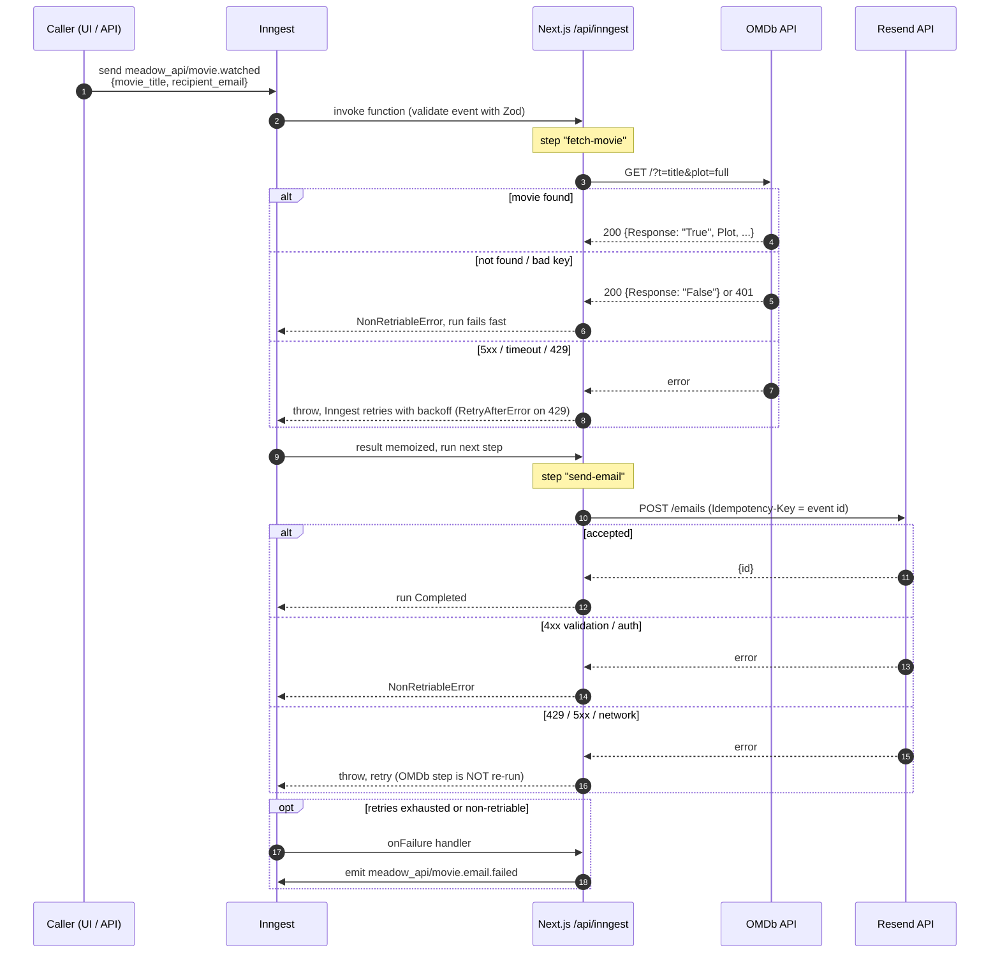

# Meadow · `movie.watched` Inngest function

An [Inngest](https://www.inngest.com/) function that reacts to `meadow_api/movie.watched`, looks the movie up on [OMDb](https://www.omdbapi.com/), and emails the plot to the recipient with [Resend](https://resend.com/).

Built with Next.js (App Router) + TypeScript. Inngest is served from a route handler (`/api/inngest`). A small demo page sends the event and shows the run progressing.

## How it works



## Reliability choices ("maximise the chances the email is sent")

| Concern | Choice |
|---|---|
| Transient failures | `retries: 5` (6 attempts, exponential backoff) |
| Re-doing finished work | OMDb and Resend are separate `step.run`s, so a failed email never re-queries OMDb (results are memoized) |
| Duplicate emails | Resend `Idempotency-Key` = Inngest event id: a retry after an ambiguous timeout cannot send twice |
| Retrying the unretriable | Unknown movie, bad keys, invalid recipient, missing config throw `NonRetriableError`, which fails immediately instead of burning retries |
| Rate limits | `throttle: 2/s` matches Resend's default limit; `RetryAfterError` honours `Retry-After` on 429 |
| OMDb quirk | OMDb returns **HTTP 200** with `Response:"False"` for not found, so the body is parsed with Zod (a discriminated union) |
| Hung upstreams | 8s `AbortSignal.timeout` on the OMDb call |
| Empty plot | OMDb's `"N/A"` becomes a friendly fallback sentence |
| Injection | Plot/title are HTML-escaped; a plain-text part is included too |
| Visibility | `onFailure` emits `meadow_api/movie.email.failed` (hook for alerting or a dead-letter queue) |
| Bad input | The event schema (`src/inngest/client.ts`) rejects empty titles and invalid emails |

## Setup

Requires Node 20+.

```bash
npm install
cp .env.example .env.local   # then fill in OMDB_API_KEY, RESEND_API_KEY, RESEND_FROM
echo "INNGEST_DEV=1" >> .env.local
```

Run the app and the Inngest dev server in two terminals:

```bash
npm run dev
```

```bash
npx inngest-cli@latest dev -u http://localhost:3000/api/inngest
```

- Demo page: <http://localhost:3000>. Fill the form to send the event and watch the stages.
- Inngest dashboard: <http://localhost:8288> (per-step trace, retries, payloads).
- Or send the raw event:

```bash
curl -X POST http://localhost:8288/e/test -H 'content-type: application/json' \
  -d '{"name":"meadow_api/movie.watched","data":{"movie_title":"The Matrix","recipient_email":"you@example.com"}}'
```

Tests (OMDb parsing, Resend error mapping, escaping):

```bash
npm test
```

### Production
Set `INNGEST_EVENT_KEY` and `INNGEST_SIGNING_KEY` (from the Inngest dashboard), deploy, and sync the app URL `https://<host>/api/inngest`. Set `RESEND_FROM` to an address on a domain verified in Resend.

## Layout
```
src/inngest/client.ts                  client + typed, Zod-validated event definitions
src/inngest/functions/movie-watched.ts the function (steps, retry mapping, flow control)
src/lib/omdb.ts                        OMDb client -> typed ServiceError(retriable)
src/lib/email.ts                       Resend wrapper + email template
src/app/api/inngest/route.ts           Inngest serve handler
src/app/actions.ts, components/demo.tsx demo form (server action) with run-status polling
tests/                                 Vitest
```

## Assumptions
- **Inngest SDK v4** (current `inngest` package): triggers are declared inside the function options via `eventType(...)`.
- `movie_title` is passed to OMDb's `t=` (exact-title lookup, `type=movie`, full plot). Ambiguous titles resolve to whatever OMDb ranks first.
- Email content is the plot plus title/year/director/rating when available; the exercise only required the plot.
- Resend without a verified domain can only send from `onboarding@resend.dev` **to the Resend account owner's address**. Testing used that address. `RESEND_FROM` is configurable for real use.
- No persistence: the Inngest run history is the record of what was sent.

## Recommendations for improving this exercise
1. **Provide a ready sandbox**: a verified Resend sender/domain or a documented test inbox, plus a shared OMDb key. Candidates otherwise lose time on the Resend "only send to yourself" restriction, which says nothing about their skill.
2. **Specify edge-case expectations**: what should happen for "movie not found", ambiguous titles, or `Plot: "N/A"`? Today every candidate invents different behaviour, which makes submissions hard to compare.
3. **Ship a fixture event and a mock OMDb response** so reviewers can run every submission against the same inputs, including failure injection.
4. **State the Inngest SDK version**, since v3 and v4 differ in how functions and triggers are declared.
